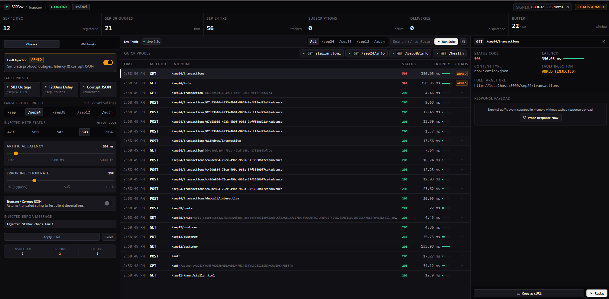
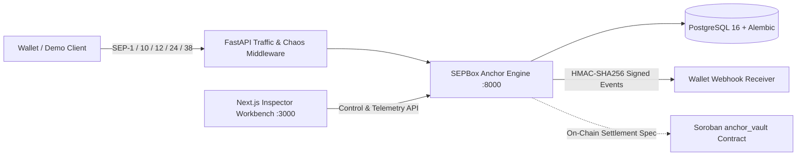

# SEPBox

[](https://github.com/sepbox-dev/sepbox/actions/workflows/ci.yml)

**Local-first Stellar SEP Anchor Engine, Chaos Fault Injector, Soroban Settlement Vault, and Live Traffic Workbench.**

Wallet and fintech teams building on Stellar typically struggle to test `SEP-1`, `SEP-10`, `SEP-12`, `SEP-24`, and `SEP-38` integrations against unreliable public test anchors—especially edge cases like `503` outages, latency spikes, truncated JSON responses, expired quotes, or failed webhook deliveries. **SEPBox** gives you a deterministic, Dockerized anchor stack on `localhost` with real Ed25519 cryptography, PostgreSQL persistence, a Soroban settlement vault contract, and a real-time inspection UI.


*SEPBox 3-pane Workbench: live SEP-1/10/12/24/38 traffic stream, Chaos fault injection (`503` + latency), and real-time request/cURL inspection.*

---

## Architecture



### Monorepo Layout

| Directory | Stack | Responsibility |
| :--- | :--- | :--- |
| `engine/` | Python 3.12, FastAPI, SQLAlchemy 2, Alembic, `stellar-sdk`, PyJWT | Real SEP-1/10/12/24/38 endpoints, row-locked state machines, chaos middleware, HMAC-SHA256 webhook dispatcher, and traffic ring buffer. |
| `contracts/` | Rust, `soroban-sdk 29.0.1`, `stellar-cli` | `anchor_vault` smart contract handling SAC token liquidity, `tx_id` idempotent deposit/withdrawal settlement, operator rotation, and pause circuit breaker. |
| `inspector/` | Next.js 16, React 19, TypeScript, Tailwind CSS v4 | 3-pane master-detail developer workbench for live traffic inspection, cURL export, chaos fault control, and webhook delivery replay. |
| `scripts/` | Python (`httpx`, `stellar-sdk`) | End-to-end cryptographic protocol runner (`demo_flow.py`) exercising the full anchor lifecycle against a running engine. |

---

## Quickstart (Under 2 Minutes)

### Prerequisites
- Docker Desktop (with Docker Compose v2)

### 1. Boot the Full Stack

```bash
git clone https://github.com/sepbox-dev/sepbox.git
cd sepbox
docker compose up --build -d
```

PostgreSQL 16 boots with healthchecks, Alembic applies migrations (`0001` through `0003`) automatically on engine startup, and both services come online:

- **Anchor Engine API:** `http://localhost:8000` (OpenAPI docs at `http://localhost:8000/docs`)
- **Inspector Workbench:** `http://localhost:3000`

### 2. Run the End-to-End Live Demo Flow

Execute a real cryptographic flow (`SEP-1` discovery -> `SEP-10` Ed25519 challenge signing -> `SEP-12` KYC verification -> `SEP-38` NGN->USDC firm quote -> `SEP-24` deposit & withdrawal state transitions) directly inside the engine container with zero local Python setup:

```bash
docker compose cp scripts/demo_flow.py engine:/tmp/demo_flow.py
docker compose exec engine python /tmp/demo_flow.py
```

Open **`http://localhost:3000`** to inspect every captured request, arm chaos fault rules (`503` outages, artificial latency, truncated JSON), or replay signed webhooks.

---

## Protocol & Control Plane Matrix

| Surface | Endpoints | Highlights |
| :--- | :--- | :--- |
| **SEP-1 Discovery** | `GET /.well-known/stellar.toml` | Dynamically serves network passphrase, anchor Ed25519 signing key, CORS header, and `USDC` / `XLM` asset metadata. |
| **SEP-10 Web Auth** | `GET /auth`, `POST /auth` | Real `stellar-sdk` challenge XDR generation, client Ed25519 signature verification, memo support, JSON & form-encoded submission, and HS256 JWT issuance. |
| **SEP-12 KYC** | `GET / PUT /sep12/customer`, `DELETE /sep12/customer/{account}` | JWT-scoped customer profiles persisted in PostgreSQL (`NEEDS_INFO` -> `ACCEPTED`) with cross-account isolation. |
| **SEP-38 FX Quotes** | `GET /sep38/info`, `/prices`, `/price`, `POST / GET /sep38/quote` | Fixed-precision `Decimal` math (7 Stellar decimal places, zero float drift) across `USD`, `NGN`, `USDC`, and `XLM` with expiring firm quotes. |
| **SEP-24 Interactive** | `GET /sep24/info`, `POST /sep24/transactions/{deposit,withdraw}/interactive`, `GET /transaction(s)`, `POST /transactions/{id}/advance` | Deterministic deposit and withdrawal state machines protected by PostgreSQL `SELECT ... FOR UPDATE` row locking and linked `SEP-38` quotes. |
| **Chaos Engine** | `GET / PUT /admin/chaos`, `POST /admin/chaos/reset` | Inject configurable latency (`0-10000ms`), HTTP status failures (`429/500/502/503/504`), or truncated JSON on any route prefix while keeping `/health` and `/admin/*` protected. |
| **Signed Webhooks** | `GET / POST / DELETE /admin/webhooks`, `GET /deliveries`, `POST /deliveries/{id}/replay` | Dispatches `sep24.transaction.updated` events signed with timestamped `X-SEPBox-Signature: t=...,v1=<hmac_sha256>`, persisted to PostgreSQL with one-click replay. |
| **Traffic Inspector** | `GET / DELETE /admin/traffic`, `GET /admin/overview` | Thread-safe 200-request ring buffer capturing latency, status, content-type, and chaos flags while excluding internal `/admin/*` polling and `OPTIONS` preflights. |

---

## Soroban `anchor_vault` Smart Contract

Located in `contracts/anchor_vault/src/lib.rs`, the vault contract models on-chain anchor liquidity and settlement on Soroban:

- **`initialize(admin, operator, token)`** — One-time vault setup binding admin, hot settlement operator, and a Stellar Asset Contract (SAC) token.
- **`fund_vault(from, amount)`** — Transfers SAC liquidity into the vault via `soroban_sdk::token::Client`.
- **`settle_deposit(tx_id, recipient, amount, fee)`** — Operator-authorized payout enforcing strict `BytesN<32>` `tx_id` idempotency in persistent storage (with explicit TTL extensions) to prevent double disbursement on retries.
- **`record_withdrawal(tx_id, sender, amount, fee)`** — User-authorized on-chain token intake recorded against the SEP-24 correlation ID.
- **`set_paused(paused)` / `set_operator(new_operator)`** — Admin circuit breaker and operator key rotation without redeploying the vault.

### Building & Testing the Contract

Requires Rust stable (`wasm32v1-none` target) and `stellar-cli` (`v25.2.0+`):

```bash
cd contracts
cargo test --verbose
stellar contract build
```

---

## Verification & Automated Tests

Every push and pull request runs three parallel GitHub Actions jobs in `.github/workflows/ci.yml`:

1. **`engine-tests`** — Spins up PostgreSQL 16, runs `alembic upgrade head`, and executes **39 pytest integration tests**:
   ```bash
   docker compose exec engine pytest -v
   ```
2. **`contract-tests`** — Executes **7 Soroban unit tests** (`cargo test`) and compiles the release WASM artifact (`stellar contract build`).
3. **`inspector-build`** — Runs a full Next.js production build (`npm run build`) and strict TypeScript check (`npm run typecheck`).

---

## Configuration

Default local development variables live in `.env.example`. Copy to `.env` to override defaults such as `ANCHOR_SIGNING_SEED` (leave blank to auto-generate an ephemeral testnet Ed25519 keypair on boot) or `JWT_SECRET`.

---

## Contributing & Security

- Read [`CONTRIBUTING.md`](CONTRIBUTING.md) for local setup, commit conventions, and pull request guidelines.
- Review [`inspector/DESIGN.md`](inspector/DESIGN.md) before modifying the Next.js workbench UI.
- Report security issues following [`SECURITY.md`](SECURITY.md).